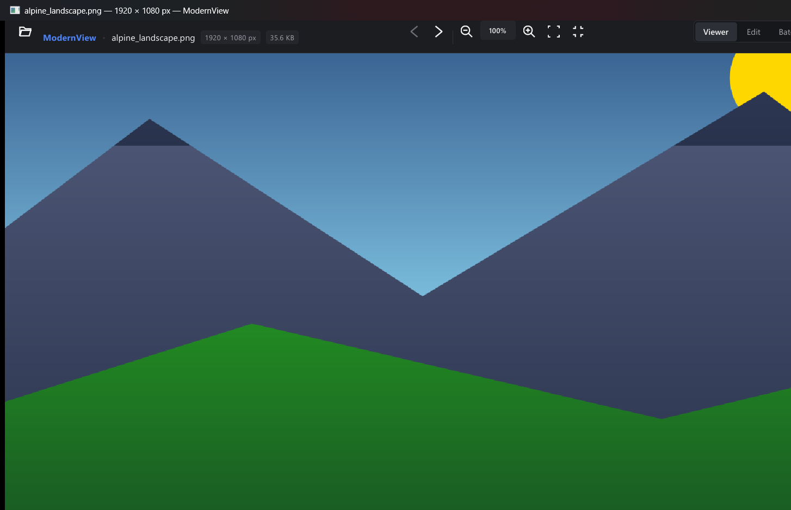

# ModernView

A fast, modern, and lightweight native image viewer and editor for Windows.



## Overview

ModernView is a desktop image application written in Rust using the Slint UI framework. It is designed to be an efficient, responsive, and elegant utility for everyday photo viewing, editing, and file organization on Windows 10 and 11.

- **Fast Startup & Cold Loading**: Optimized decoders load full-resolution images in milliseconds.
- **Minimal Footprint**: Self-contained compiled native binary without browser or web-view runtimes.
- **Refined Interface**: Dark and light themes inspired by modern minimalist design principles, with clear typography and solid surfaces.
- **Windows Integration**: Native integration with Windows Explorer context menus ("Open With") and system Default Apps.

---

## Features

### Image Viewing
- Smooth cursor-centered zooming and panning.
- One-click fit-to-window and actual-size (1:1 pixel) modes.
- Transparency checkerboard grid with alpha blending support.
- Automatic EXIF orientation normalization for portrait/landscape shots.

### Folder Browsing & Filmstrip
- Horizontal filmstrip at the bottom displaying folder thumbnails.
- Thumbnails generated lazily on background worker threads.
- Natural alphanumeric ordering for numbered image sequences.
- Left-hand sidebar for quick navigation to frequent folders and recent files.

### Image Editing
- Non-destructive adjustments for brightness, contrast, and saturation.
- 90-degree rotations and horizontal/vertical flips.
- Precision crop tool with aspect ratio locks.
- Resampling with Bilinear and Lanczos3 interpolation powered by SIMD acceleration.
- Complete undo and redo history with original revert capability.

### Image Comparison
- Side-by-side split screen to compare two images.
- Synchronized zoom and pan controls.
- One-click image swap and difference inspection.

### Batch Processing
- Multi-threaded batch processor using Rayon work-stealing queues.
- Batch convert, resize, and rename collections of images concurrently.

### Metadata & Inspector
- Collapsible sidebar showing format, resolution, aspect ratio, file size, and color depth.
- Camera EXIF data reader: camera make, lens, exposure, aperture, ISO, and capture date.

---

## Download & Installation

You **do not** need Rust or build tools installed to run ModernView.

- **Standalone Portable**: Download [`ModernView-v0.1.0-windows-x64.zip`](https://github.com/Naveen-io/ModernView/releases), extract anywhere, and run `modernview.exe` directly.
- **One-Click Windows Setup**: Run `setup.bat` inside the extracted folder. It installs ModernView to `%LOCALAPPDATA%\Programs\ModernView`, creates Desktop and Start Menu shortcuts, and registers Windows "Open With" context menus and Default App associations.
- **Clean Uninstallation**: Run `uninstall.bat` at any time to remove all shortcuts, registry keys, and program files.

---

## Memory Footprint & Resource Telemetry

ModernView is engineered for minimal resource consumption and zero bloat:

- **Executable Size**: **18.16 MB** standalone native executable (7.8 MB compressed in release ZIP) containing all GUI assets, fonts, icons, decoders, and SIMD resizers. Zero external DLLs or runtimes required.
- **Idle Memory (RAM)**: **~80 MB** private working set on cold startup (~150 MB total working set including the Windows 11 GPU DirectX swapchain).
- **Active Viewing (RAM)**: **~190 MB** private working set under active viewing of full-resolution images with preloaded filmstrip previews and the LRU background cache.
- **Cache Management**: Bounded LRU in-memory image cache with user-configurable memory limits (Settings > Cache Limit) to prevent RAM runaway.

---

## Supported Formats

ModernView includes native, memory-safe pure-Rust decoders for a wide variety of modern and traditional formats:

| Format | Extensions | Capabilities | Decoder Engine |
| :--- | :--- | :--- | :--- |
| **JPEG** | `.jpg`, `.jpeg` | Read & Quality-Controlled Write | `image` (zune-jpeg) |
| **PNG** | `.png` | Read & Lossless Write (32-bit RGBA) | `image` (png-rs) |
| **WebP** | `.webp` | Read & Lossy/Lossless Write | `image` (image-webp) |
| **AVIF** | `.avif` | Read (AV1 Still Image) | `oxideav-avif` |
| **HEIC / HEIF**| `.heic`, `.heif` | Read (iPhone & Camera HEVC Stills) | `zune-heic` (SSE4.1 SIMD) |
| **QOI** | `.qoi` | Read (Quite OK Image format) | `qoi` |
| **TGA** | `.tga` | Read (Gaming & 3D textures) | `image` (tga) |
| **HDR** | `.hdr` | Read (Radiance High Dynamic Range) | `image` (hdr) |
| **BMP** | `.bmp` | Read (Standard Windows Bitmap) | `image` (bmp) |
| **GIF** | `.gif` | Read (Static & Animated preview) | `image` (gif) |
| **TIFF** | `.tiff`, `.tif` | Read (Baseline Multi-channel TIFF) | `image` (tiff) |
| **ICO** | `.ico` | Read (Windows Icon resources) | `image` (ico) |
| **PNM** | `.ppm`, `.pgm`, `.pbm`, `.pnm` | Read (Portable Anymap) | `image` (pnm) |
| **Farbfeld** | `.ff` | Read (16-bit RGBA raw format) | `image` (ff) |

---

## Performance Benchmarks & Methodology

### Test Environment
- **CPU**: 11th Gen Intel(R) Core(TM) i5-11400H @ 2.70GHz (6 physical cores, 12 logical threads, AVX2/AVX-512)
- **RAM**: 16 GB DDR4 (3200 MHz)
- **OS**: Microsoft Windows 11 Pro 64-bit (Version 10.0.26300)
- **Storage**: High-Speed NVMe PCIe M.2 SSD
- **Build**: Rust 1.99.0 (`x86_64-pc-windows-msvc`), Release profile (`opt-level = 3`, `lto = "thin"`, `codegen-units = 1`, `panic = "abort"`, `strip = true`)

### Benchmark Dataset & Results
Measured across realistic 1080p (1920 × 1080, 2.07 Megapixels) and 4K images averaged over 10 to 50 iterations:

| Operation | Target / Dataset | Latency | Throughput |
| :--- | :--- | :--- | :--- |
| **WebP Cold Decode** | 1080p (1920 × 1080) | **8.48 ms** | **117.9 fps** |
| **JPEG Cold Decode** | 1080p (1920 × 1080) | **16.00 ms** | **62.5 fps** |
| **PNG Cold Decode** | 1080p (1920 × 1080) | **25.53 ms** | **39.2 fps** |
| **Lanczos3 High-Quality Resample** | 1080p → 540p | **16.34 ms** | **61.2 fps** |
| **Bilinear Resample** | 1080p → 540p | **13.86 ms** | **72.2 fps** |
| **Thumbnail Generation** | 1080p → 96px filmstrip preview | **8.20 ms** | **122 thumbnails/sec** |
| **Live Adjustments (LUT)** | 1080p (2.07M Pixels) | **13.84 ms** | **149.8 MP/sec** |
| **Parallel Batch Processing** | 10 images concurrent (Rayon) | **0.19 s total** | **52.0 images/sec** |

You can reproduce these benchmarks at any time on your own machine:
```cmd
cargo run --release --bin benchmark
```

---

## Why ModernView? (Comparison with Legacy Viewers)

Established viewers like IrfanView have been developed for decades and offer specialized legacy features such as TWAIN scanner drivers and 32-bit Adobe 8BF plugins. ModernView is not designed to replace niche 1990s desktop workflows; it is built ground-up for 2026 workflows:

1. **Memory Safety & Zero Vulnerabilities**:
   Decades of C/C++ image parsing code in legacy viewers have been a constant source of CVE security advisories (heap buffer overflows, out-of-bounds reads, arbitrary code execution via crafted image headers). ModernView is written in **100% memory-safe Rust**, ensuring bounds checking and memory safety across all decoders.
2. **Hardware-Accelerated UI & High-DPI Fluidity**:
   Legacy Win32 GDI interfaces frequently experience blurriness, tearing, or broken fractional scaling on 4K/HDR Windows 11 monitors. ModernView uses Slint's direct GPU pipeline (DirectX/FemtoVG), delivering smooth 120Hz/144Hz trackpad zooming, cursor-centered panning, and crisp sub-pixel text.
3. **Interactive A/B Comparison Engine**:
   Native side-by-side comparison with synchronized pan/zoom and difference sliders, allowing photographers and designers to compare compression levels or color grades without third-party plugins.
4. **Predictive Multithreaded Caching**:
   ModernView pre-decodes adjacent images on background worker threads using Rayon work-stealing, giving you instant (0 ms perceived latency) browsing through large folders of photos.
5. **Completely Self-Contained & Respectful**:
   No background telemetry, no autoupdaters silently running in Task Manager, no advertisements, and a single portable ~18 MB binary that doesn't litter your system registry unless you explicitly choose to register file associations.

---

## Technology Stack

- **Language**: Rust
- **GUI Framework**: Slint (v1.9)
- **Image Processing**: `image` crate (v0.25)
- **SIMD Resizing**: `fast_image_resize` (v5)
- **Metadata**: `kamadak-exif` (v0.5)
- **Concurrency**: `rayon` (v1.10)
- **Dialogs**: `rfd` (v0.15)

---

## Build Instructions

### Prerequisites
- Windows 10 or 11 (64-bit)
- Rust toolchain (stable) with Cargo
- Visual Studio C++ Build Tools (MSVC)

### Building
```powershell
# Clone the repository
git clone https://github.com/Naveen-io/ModernView.git
cd ModernView

# Run tests
cargo test

# Build optimized release binary
cargo build --release
```

The resulting binary will be created at `target\release\modernview.exe`.

---

## Windows Integration & Default App Setup

ModernView can be integrated directly into Windows Explorer on any Windows machine:

1. **One-Click Setup**:
   Simply run `setup.bat` (or `setup.ps1` in PowerShell) from the repository root:
   ```cmd
   setup.bat
   ```
   This automatically installs ModernView to `%LOCALAPPDATA%\Programs\ModernView`, creates Desktop and Start Menu shortcuts, registers the Explorer context menu, and enables Windows Default App compatibility.

2. **Via ModernView Settings**:
   Open ModernView, go to Settings (`Ctrl + ,`), open the **About** tab, and click **Register 'Open With' & Default App Handler**.

3. **Via Standalone Registration Script**:
   ```powershell
   powershell -ExecutionPolicy Bypass -File scripts\register_associations.ps1
   ```

4. **Setting ModernView as Default**:
   - Open Windows **Settings** (`Win + I`) > **Apps** > **Default apps**.
   - Select **ModernView** to associate it with all image formats (.jpg, .png, .webp, .bmp, .gif, .tiff, .ico).

---

## Keyboard Shortcuts

| Shortcut | Action |
| :--- | :--- |
| `Ctrl + O` | Open File |
| `Ctrl + Shift + O` | Open Folder |
| `Ctrl + S` | Save File |
| `Ctrl + Shift + S` | Export As |
| `Ctrl + Z` / `Ctrl + Y` | Undo / Redo |
| `Right Arrow` / `Space` | Next Image |
| `Left Arrow` / `Backspace` | Previous Image |
| `+` / `Mouse Wheel Up` | Zoom In |
| `-` / `Mouse Wheel Down` | Zoom Out |
| `0` | Fit to Window |
| `1` | 100% Actual Size |
| `E` | Toggle Edit Mode |
| `I` | Toggle Inspector Panel |
| `F` / `F11` | Toggle Fullscreen |
| `Ctrl + ,` | Settings |
| `Esc` | Close Active Panel |

---

## Project Status

ModernView is actively maintained. Version 0.1.0 delivers complete core functionality including image decoding, folder navigation, editing, batch processing, comparison, and Windows shell registration.
